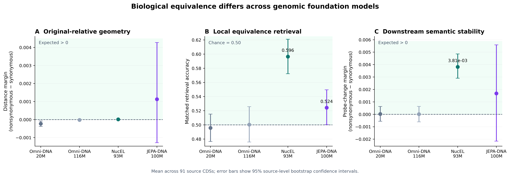

# Beyond Perturbation Robustness: Do Genomic Foundation Models Learn Biological Equivalence?

[](https://github.com/pj-mohanty/biological-equivalence-gfms/actions/workflows/validate.yml)
[](LICENSE)
[](LICENSE-DATA.md)

Robustness benchmarks ask whether a genomic foundation model's representation
survives a small input perturbation. Coding DNA allows a sharper question.
Because of the genetic code, some single-codon edits leave the encoded protein
**identical** (synonymous) while others of the same nucleotide magnitude
**change it** (nonsynonymous). A model that has internalised that structure
should not treat the two alike.

This repository evaluates four genomic foundation models on **edit-matched**
synonymous and nonsynonymous variants of human coding sequences, and asks
whether protein-preserving variants are represented as *equivalent*.

> **Headline.** Biological-equivalence geometry is **model-dependent, not
> scale-dependent**. On an identical 91-sequence cohort, both Omni-DNA scales
> retrieve equivalent variants at chance, a 6× parameter increase does not
> help, NucEL-93M is reliably above chance, and JEPA-DNA-NTv3-100M is
> inconclusive.

| Model | Equivalence retrieval accuracy (chance = 0.5) | 95% CI |
| --- | ---: | --- |
| Omni-DNA-20M | 0.4957 | [0.4766, 0.5153] |
| Omni-DNA-116M | 0.5004 | [0.4758, 0.5258] |
| **NucEL-93M** | **0.5965** | **[0.5723, 0.6210]** |
| JEPA-DNA-NTv3-100M | 0.5243 | [0.5004, 0.5496] |

<sub>n = 91 source CDSs, 90 forced-choice trials each, 95% percentile bootstrap over source
sequences (10,000 resamples). Source:
[`results/final_four_model_structural_comparison_91.csv`](results/final_four_model_structural_comparison_91.csv).</sub>

---

## The experimental idea

Take a human coding sequence. Edit one codon so the protein is unchanged
(**synonymous**). Separately, edit the *same codon position* with the *same
number of nucleotide substitutions* so the protein changes
(**nonsynonymous**). The two variants are matched on everything except
biological meaning.

```text
original       ... TCG ...   → Ser
synonymous     ... AGC ...   → Ser      same protein, 3 nt changed
nonsynonymous  ... ACG ...   → Thr      different protein, 3 nt changed  (matched)
```

Compose up to three such edits along a path, generate ten independent paths
per sequence, and the ten synonymous endpoints form an **equivalence class**:
all encode the identical protein. The question becomes geometric — does the
model keep that class tighter than the matched nonsynonymous class, and can it
retrieve an equivalent variant over a matched non-equivalent one?

Matching is not assumed; it is verified. The test suite recomputes every
translation from the standard genetic code and every Hamming distance from
the sequences themselves.

## Design at a glance

| | |
| --- | --- |
| **Data** | Ensembl *Homo sapiens* GRCh38 CDS, SHA-256 verified |
| **Cohorts** | 300 pilot → 100 structural → 91 cross-family (strictly nested) |
| **Transformations** | Synonymous edits validated by full-CDS retranslation; nonsynonymous controls matched on codon position and per-step nucleotide Hamming distance |
| **Depth** | 1–3 composed edits; 10 independent paths per source (structural) |
| **Representation** | Mean pooling over non-special biological tokens; no truncation ever |
| **Metrics** | Composition drift, endpoint dispersion, equivalence-class geometry, forced-choice retrieval, downstream protein-semantic probe |
| **Statistics** | Source-level paired percentile bootstrap, 10,000 resamples, seed 42 |

## Models evaluated

| Model | Checkpoint | Dim | Role |
| --- | --- | ---: | --- |
| Omni-DNA-20M | `zehui127/Omni-DNA-20M` | 256 | Primary pilot and structural model |
| Omni-DNA-116M | `zehui127/Omni-DNA-116M` | 768 | Same-family scale replication |
| NucEL-93M | `FreakingPotato/NucEL` | 512 | Cross-family replication |
| JEPA-DNA-NTv3-100M | `nvidia/NV-JEPA-DNA-NTv3` (gated) | 768 | Cross-family replication, JEPA objective |

All four are pinned to exact commit revisions in
[`configs/experiment.yaml`](configs/experiment.yaml). No weights are
redistributed here.

---

## Findings



**1. The pre-specified pilot test is null.** Representation drift grows with
composition depth under both conditions, but near-identically. The
difference-in-differences (depth 3 − depth 1) is
+5.91e-05 [−1.46e-04, +2.73e-04] — an interval containing zero. Omni-DNA-20M
is sensitive to the edits, but not differentially to their biological meaning.
This was the registered primary outcome and is recorded as decision D021.

**2. Scale does not rescue it.** Going from 20M to 116M parameters compresses
absolute cosine distances by about an order of magnitude but leaves retrieval
at chance (0.4973 → 0.5062 on the 100-source cohort) and does not flip the
sign of any geometry metric.

**3. Pretraining family does matter.** On the identical 91-source cohort,
NucEL-93M is the only model whose intervals exclude zero in the
equivalence-supporting direction on all three structural geometry metrics, and
its downstream probe margin (3.81e-03 [2.90e-03, 4.86e-03]) holds for 92% of
individual sources.

**4. JEPA-DNA is inconclusive here.** Four of five structural intervals
straddle zero and its retrieval lower bound sits at 0.5003. On this cohort it
cannot be distinguished from chance; it is not reported as a positive result.

**Effect sizes are small in absolute terms** (1e-5 to 1e-3 cosine distance),
which is why conclusions rest on forced-choice retrieval against a 0.5 chance
reference and on signed within-source paired contrasts, not on raw distances.

Full numbers, with every value cited to its source file:
**[docs/results.md](docs/results.md)**.

### What this does not show

No claim is made that any model does or does not "understand" the genetic
code; these are geometric probes of frozen representations. The design cannot
attribute NucEL's advantage to any single cause — data, objective,
tokenisation and architecture all differ at once. Results cover human CDSs
that fit a 250-token Omni-DNA context, depths 1–3, n ≤ 300. Analyses beyond
the pilot are extensions, not pre-registered tests.

---

## Verify the artifacts yourself

CPU-only, no model downloads, runs in seconds:

```bash
git clone https://github.com/pj-mohanty/biological-equivalence-gfms.git
cd biological-equivalence-gfms
pip install -r requirements-validation.txt

pytest -q                           # checks over datasets, alignment, results
python scripts/verify_artifacts.py  # SHA-256 integrity of every artifact
```

Checks that need `torch` (reading the `.pt` embedding tensors) and tables that
report no confidence intervals are skipped automatically, so a plain run
reports a mix of passes and skips; both are expected.

The suite independently re-derives the study's core guarantees rather than
trusting recorded columns: it retranslates every synonymous variant from the
standard genetic code, recomputes every edit distance, confirms the cohorts
are strictly nested, checks each embedding tensor against its metadata table
row-for-row, and verifies that every reported confidence interval brackets its
estimate and agrees across result tables.

## Repository layout

| Path | Contents |
| --- | --- |
| [`synonymous_composition.ipynb`](synonymous_composition.ipynb) | Frozen 161-cell experiment record, outputs retained |
| [`data/`](data) | Ensembl source, frozen cohorts, variants, matched controls |
| [`embeddings/`](embeddings) | Pooled representations (`.pt`) with row-aligned metadata |
| [`results/`](results) | Distances, bootstrap summaries, retrieval, probe outputs |
| [`figures/`](figures) | Publication figures (`.png` + `.pdf`) |
| [`metadata/`](metadata) | Provenance, pre-specified design, per-edit audit, manifests |
| [`logs/decision_log.txt`](logs/decision_log.txt) | 21 numbered design decisions (D001–D021) |
| [`docs/`](docs) | Methodology, dataset, results, reproducibility, structure, manifest |
| [`tests/`](tests), [`scripts/`](scripts), [`configs/`](configs) | Validation suite, integrity tools, configuration record |

Detailed map: [docs/repository_structure.md](docs/repository_structure.md).

Three files are excluded from version control because they exceed GitHub's
100 MB limit and are regenerable (the raw FASTA and two intermediate candidate
tables). Nothing needed to check the paper's numbers depends on them.

## Reproduction

| Layer | Status | Requires |
| --- | --- | --- |
| Artifact integrity, dataset guarantees, result consistency | **Verified, reproducible here** | Python + pandas |
| Statistical results from saved embeddings | Possible, not one command | Notebook cells with `PROJECT_ROOT` repointed |
| Embedding regeneration (Omni-DNA, NucEL) | Not reproducible here | GPU, pinned checkpoints, `transformers==4.48.3` |
| Embedding regeneration (JEPA-DNA) | Not reproducible here | GPU + gated checkpoint access + NVIDIA custom code |

The notebook is a faithful log of an exploratory session, including dependency
repairs and two runtime restarts; **it does not run top to bottom**, and this
repository does not claim otherwise. The reproducible objects are the frozen
artifacts. Details, including the proposed extraction of the analysis into a
package and the open provenance questions:
**[docs/reproducibility.md](docs/reproducibility.md)**.

**Compute used:** single NVIDIA Tesla T4 (Google Colab), Python 3.12.13,
PyTorch 2.11.0+cu128, `transformers` 4.48.3, float32, batch size 32
(Omni-DNA) / 16 (JEPA-DNA). Wall-clock time was not recorded.

## Documentation

| Document | Contents |
| --- | --- |
| [methodology.md](docs/methodology.md) | Design, transformations, representations, metric definitions, statistics |
| [dataset.md](docs/dataset.md) | Provenance, filtering rules, every data file and column |
| [results.md](docs/results.md) | Every reported number, cited to its result file |
| [reproducibility.md](docs/reproducibility.md) | What is reproducible, what is not, and open questions |
| [repository_structure.md](docs/repository_structure.md) | Full file map and traceability chain |
| [artifact_manifest.md](docs/artifact_manifest.md) | All 111 artifacts with sizes and SHA-256 digests |

## Citation

If you use this repository or its artifacts, please cite it via
[`CITATION.cff`](CITATION.cff).

Author: Padmaja Mohanty, University of San Francisco (subject to final
verification before public release).

> **TODO (author):** add a `preferred-citation` block to `CITATION.cff` once
> the accompanying paper has a citable record (venue, year, DOI or arXiv ID).
> No ORCID or publication identifier is recorded, because none has been
> verified; these fields are omitted rather than filled with placeholders.

## License

Code is MIT ([LICENSE](LICENSE)); data and derived artifacts are CC BY 4.0
([LICENSE-DATA.md](LICENSE-DATA.md)). Sequence data derives from Ensembl,
which releases its data without restriction. Pretrained checkpoints remain
under their own upstream licenses and are not redistributed here.

## Acknowledgments

> **TODO (author):** add acknowledgments (funding, compute, advisors,
> reviewers). None are recorded in the repository's artifacts, so none are
> asserted here.
